# Smart Cold Storage: Sistem IoT Kendali Suhu dan Monitoring Kesegaran Ikan


Prototipe cold storage berbasis ESP32 untuk menjaga suhu penyimpanan ikan dan memantau kesegarannya secara real-time. Sistem membaca suhu (DS18B20) dan kadar amonia (MQ-135), mengatur daya pendingin Peltier dengan metode Fuzzy Logic, lalu mengirim data ke Google Sheets melalui Google Apps Script untuk ditampilkan pada dashboard web.

<p align="center">
  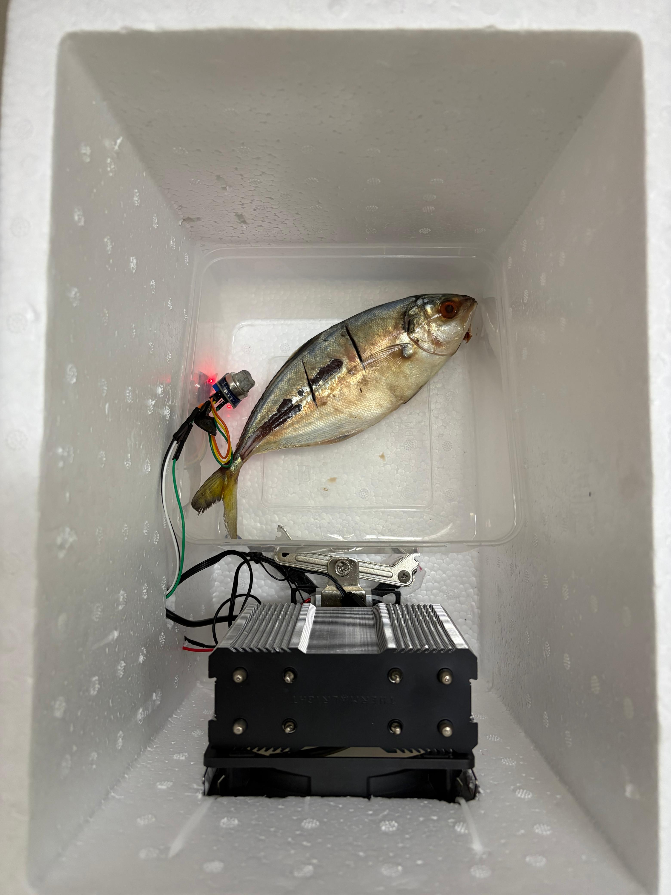
</p>

---

## Daftar Isi

- [Fitur Utama](#fitur-utama)
- [Arsitektur Sistem](#arsitektur-sistem)
- [Perangkat Keras](#perangkat-keras)
- [Skema Rangkaian](#skema-rangkaian)
- [Cara Kerja](#cara-kerja)
- [Instalasi dan Penggunaan](#instalasi-dan-penggunaan)
- [Format Data](#format-data)
- [Hasil Pengujian](#hasil-pengujian)
- [Dokumentasi Alat](#dokumentasi-alat)
- [Struktur Repositori](#struktur-repositori)
- [Keterbatasan dan Pengembangan Lanjutan](#keterbatasan-dan-pengembangan-lanjutan)

---

## Fitur Utama

- Monitoring suhu ruang penyimpanan dengan sensor digital DS18B20.
- Deteksi amonia sebagai indikator pembusukan ikan dengan sensor gas MQ-135.
- Klasifikasi kesegaran ikan secara otomatis: `segar`, `waspada`, atau `busuk`.
- Kendali daya Peltier berbasis Fuzzy Logic (metode Sugeno, rata-rata berbobot) melalui sinyal PWM ke buck converter.
- Kendali kipas otomatis untuk pembuangan panas dan sirkulasi udara.
- Pencatatan data ke Google Sheets melalui Google Apps Script dengan interval sekitar 5 detik.
- Dashboard web untuk memantau suhu, amonia, status kesegaran, dan kinerja Peltier.

---

## Arsitektur Sistem

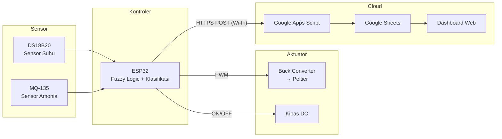

---

## Perangkat Keras

### Daftar Komponen

| No | Komponen | Fungsi |
|----|----------|--------|
| 1 | ESP32 DevKit (ESP-WROOM-32) | Mikrokontroler utama dan koneksi Wi-Fi |
| 2 | DS18B20 | Sensor suhu ruang penyimpanan |
| 3 | MQ-135 | Sensor gas amonia (indikator kesegaran ikan) |
| 4 | Modul Peltier (TEC) dan heatsink | Elemen pendingin |
| 5 | Buck converter (LM2596) | Pengatur daya Peltier |
| 6 | Kipas DC | Pembuang panas heatsink dan sirkulasi udara |
| 7 | Adaptor DC dan DC jack | Catu daya sistem |
| 8 | Modem MiFi | Sumber koneksi internet |
| 9 | Kotak styrofoam | Ruang penyimpanan berinsulasi |

### Konfigurasi Pin

| Komponen | Pin ESP32 | Mode | Keterangan |
|----------|-----------|------|------------|
| DS18B20 (data) | GPIO 5 | Input (pull-up) | Protokol OneWire |
| MQ-135 (analog out) | GPIO 25 | Input analog | ADC2, lihat [Keterbatasan Sistem](#keterbatasan-sistem) |
| Buck converter / Peltier | GPIO 32 | Output PWM | Duty cycle 0–255 |
| Kipas | GPIO 34 | Output digital | Pin input-only, lihat [Keterbatasan Sistem](#keterbatasan-sistem) |

---

## Skema Rangkaian

<p align="center">
  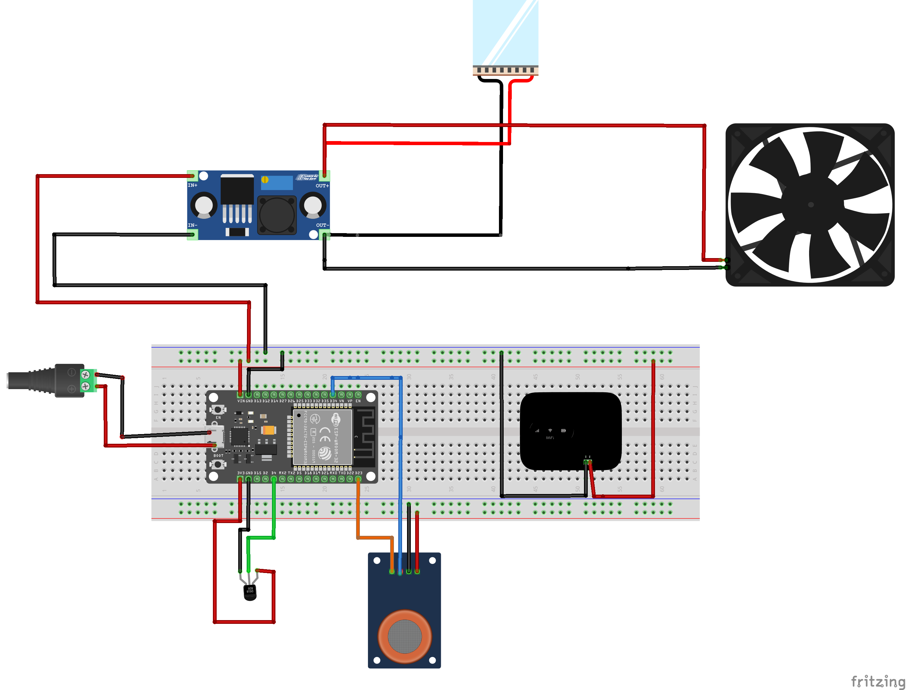
</p>

Skema dibuat menggunakan Fritzing. Jika terdapat perbedaan antara skema dan firmware, konfigurasi pin pada firmware menjadi acuan (lihat tabel [Konfigurasi Pin](#konfigurasi-pin)).

---

## Cara Kerja

Firmware menjalankan empat tahap berikut pada setiap siklus:

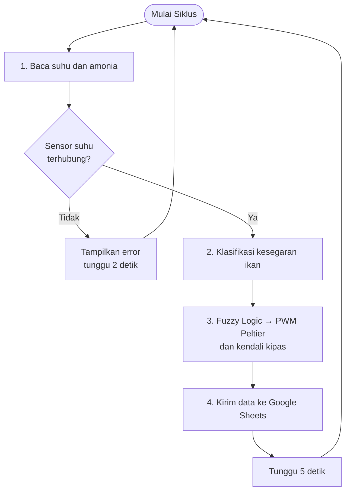

### 1. Pembacaan Sensor

- Suhu dibaca dari DS18B20 dalam satuan °C.
- Amonia dibaca dari nilai ADC MQ-135 (0–4095), kemudian dipetakan secara linier ke rentang 0–120 ppm.

### 2. Klasifikasi Kesegaran Ikan

| Status | Kondisi |
|--------|---------|
| Segar | Amonia ≤ 20 ppm dan suhu ≤ 25 °C |
| Waspada | Amonia > 20 ppm atau suhu > 25 °C |
| Busuk | Amonia ≥ 65 ppm, tanpa memperhatikan suhu |

### 3. Kendali Fuzzy Logic (Sugeno)

Suhu difuzzifikasi ke dalam tiga himpunan fuzzy, masing-masing dengan output singleton berupa nilai PWM:

| Himpunan | Fungsi Keanggotaan | Output (PWM) |
|----------|--------------------|--------------|
| Dingin | Bernilai 1 jika T ≤ 15 °C, turun linier pada 15–17,5 °C | 0 (Peltier mati) |
| Normal | Segitiga 15 – 17,5 – 20 °C | 127 (±50%) |
| Panas | Naik linier pada 17,5–20 °C, bernilai 1 jika T ≥ 20 °C | 255 (100%) |

Defuzzifikasi menggunakan rata-rata berbobot (weighted average):

$$
PWM = \frac{\mu_{dingin} \cdot 0 + \mu_{normal} \cdot 127 + \mu_{panas} \cdot 255}{\mu_{dingin} + \mu_{normal} + \mu_{panas}}
$$

Dengan pendekatan ini, daya Peltier berubah secara proporsional terhadap suhu, bukan sekadar ON/OFF. Rentang suhu kerja yang dituju adalah 15–20 °C.

Kipas dinyalakan ketika Peltier aktif (PWM > 0) atau ketika kadar amonia mencapai 65 ppm.

### 4. Pengiriman Data

Data dikirim melalui HTTPS POST (`application/x-www-form-urlencoded`) ke endpoint Google Apps Script. Script menyimpan setiap data sebagai baris baru di Google Sheets, yang kemudian dibaca oleh dashboard web.

---

## Instalasi dan Penggunaan

### Prasyarat

- [Arduino IDE](https://www.arduino.cc/en/software) 2.x
- Board package ESP32 (Espressif Systems), dipasang melalui Boards Manager
- Library berikut, dipasang melalui Library Manager:
  - `OneWire`
  - `DallasTemperature`
- Akun Google untuk Google Sheets dan Apps Script

### Langkah-langkah

1. Clone repositori.
   ```bash
   git clone https://github.com/aryajisantosa/iot-fish-temp-control.git
   cd iot-fish-temp-control
   ```

2. Siapkan Google Sheets dan Apps Script.
   - Buat Google Sheets baru, lalu buka **Extensions → Apps Script**.
   - Buat fungsi `doPost(e)` yang membaca parameter `suhu`, `amonia`, dan `status`, lalu menambahkannya sebagai baris baru di sheet.
   - Pilih **Deploy → New deployment → Web app** dengan akses *Anyone*.
   - Salin URL deployment (`https://script.google.com/macros/s/.../exec`).

3. Sesuaikan konfigurasi pada [`firmware/fish_cold_storage/fish_cold_storage.ino`](firmware/fish_cold_storage/fish_cold_storage.ino):

   | Variabel | Isi dengan |
   |----------|------------|
   | `ssid` | Nama jaringan Wi-Fi |
   | `password` | Password Wi-Fi |
   | `url_google_script` | URL deployment Google Apps Script |

4. Upload firmware ke ESP32.
   - Pilih board **ESP32 Dev Module** dan port yang sesuai.
   - Klik **Upload**.

5. Verifikasi melalui Serial Monitor.
   - Gunakan baud rate 115200.
   - Pastikan muncul pesan `Wi-Fi Terhubung!` dan setiap pengiriman berstatus `[SUKSES TERKIRIM]`.

---

## Format Data

Contoh payload yang dikirim ke Google Apps Script:

```
suhu=18.75&amonia=4.00&status=segar
```

| Parameter | Tipe | Keterangan |
|-----------|------|------------|
| `suhu` | float (2 desimal) | Suhu dalam °C |
| `amonia` | float (2 desimal) | Kadar amonia dalam ppm |
| `status` | string | `segar` / `waspada` / `busuk` |

Contoh output Serial Monitor:

```
Suhu: 18.75C | Amonia: 4.00ppm | Status: segar => [SUKSES TERKIRIM]
```

---

## Hasil Pengujian

Pengujian membandingkan kestabilan suhu dan pembacaan amonia antara sistem dengan kendali Fuzzy Logic dan tanpa Fuzzy Logic.

<table>
  <tr>
    <th></th>
    <th width="46%">Dengan Fuzzy Logic</th>
    <th width="46%">Tanpa Fuzzy Logic</th>
  </tr>
  <tr>
    <th>Suhu</th>
    <td align="center">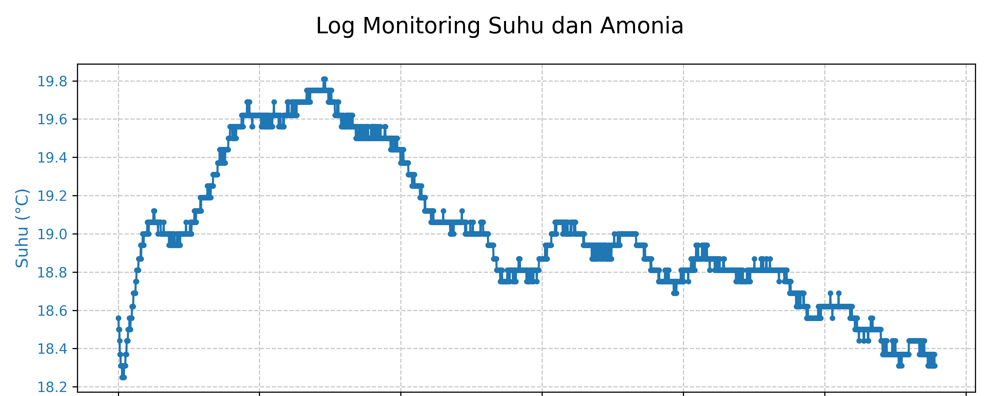</td>
    <td align="center">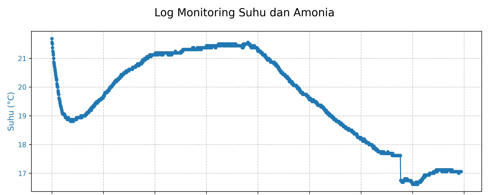</td>
  </tr>
  <tr>
    <th>Amonia</th>
    <td align="center">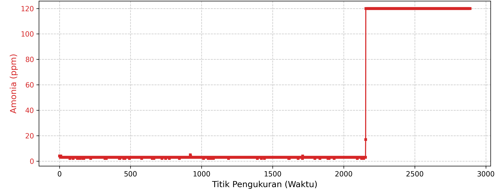</td>
    <td align="center">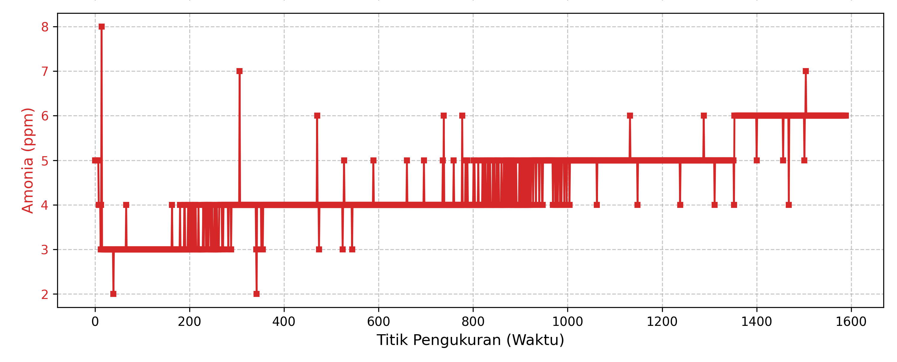</td>
  </tr>
</table>

Dengan Fuzzy Logic, suhu berada pada rentang 18,3–19,8 °C (selisih sekitar 1,5 °C). Tanpa Fuzzy Logic, rentangnya 16,6–21,7 °C (selisih sekitar 5,1 °C).

### Dashboard dan Log

<table>
  <tr>
    <th width="50%">Dashboard Web</th>
    <th width="50%">Log Serial</th>
  </tr>
  <tr>
    <td align="center">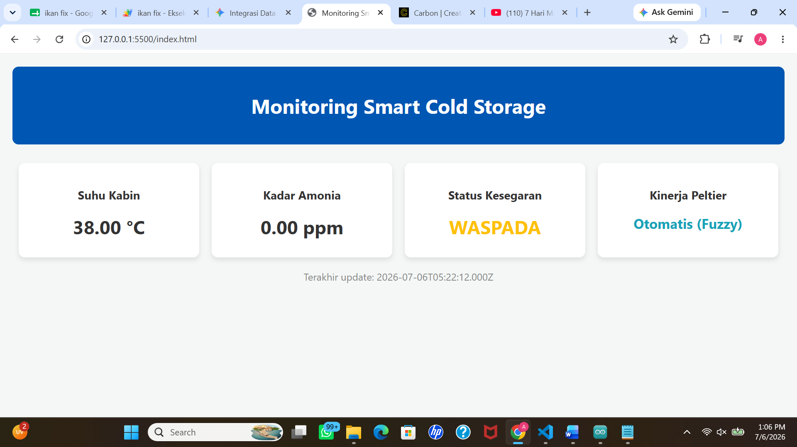</td>
    <td align="center">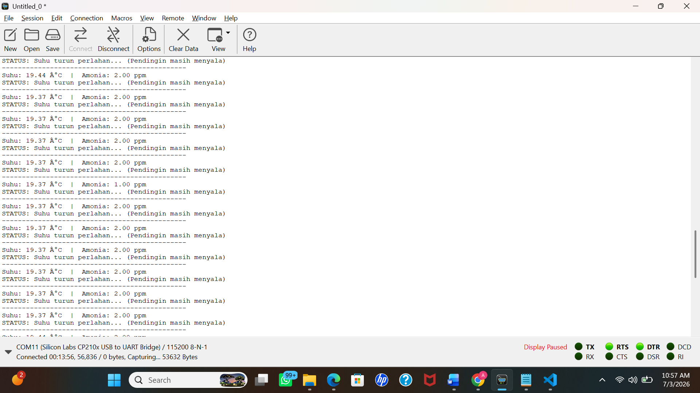</td>
  </tr>
</table>

---

## Dokumentasi Alat

<table>
  <tr>
    <th width="50%">Tampak Atas (Ruang Penyimpanan)</th>
    <th width="50%">Tampak Samping (Panel Kontroler)</th>
  </tr>
  <tr>
    <td align="center"></td>
    <td align="center">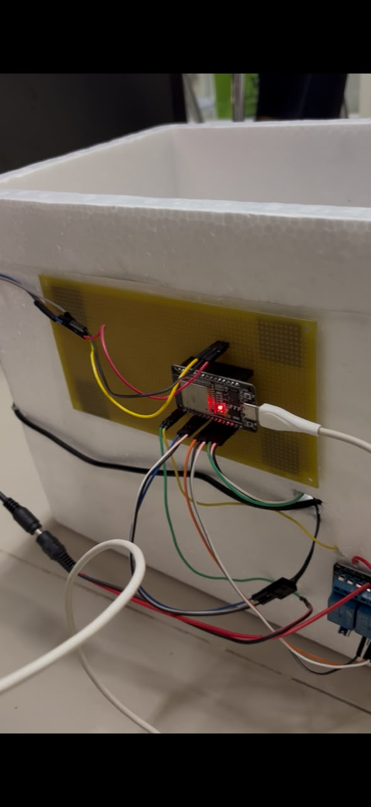</td>
  </tr>
</table>

Video demo: [docs/videos/device-demo.mp4](docs/videos/device-demo.mp4)

---

## Struktur Repositori

```
iot-fish-temp-control/
├── firmware/
│   └── fish_cold_storage/
│       └── fish_cold_storage.ino      # Firmware utama ESP32
├── docs/
│   ├── images/
│   │   ├── hardware/                  # Foto prototipe alat
│   │   ├── schematic/                 # Skema rangkaian (Fritzing)
│   │   ├── testing/                   # Grafik hasil pengujian
│   │   ├── dashboard/                 # Tampilan dashboard web
│   │   └── firmware/                  # Screenshot kode dan serial monitor
│   └── videos/
│       └── device-demo.mp4            # Video demo alat
├── .gitignore
└── README.md
```

---

## Keterbatasan dan Pengembangan Lanjutan

### Keterbatasan Sistem

1. **Pin kipas tidak mendukung output.** GPIO 34–39 pada ESP32 merupakan pin input-only, sehingga perintah `digitalWrite` pada GPIO 34 tidak menggerakkan kipas. Hal ini ditunjukkan oleh pesan `gpio: GPIO can only be used as input mode` pada Serial Monitor. Kipas perlu dipindahkan ke pin yang mendukung output, misalnya GPIO 27.

2. **Sensor amonia terhubung ke ADC2.** GPIO 25 termasuk kanal ADC2, yang tidak dapat dibaca selama Wi-Fi aktif. Kondisi ini kemungkinan menjadi penyebab nilai amonia tetap 0 ppm pada beberapa pengujian. Sensor sebaiknya dipindahkan ke kanal ADC1 (GPIO 32–39) yang tidak sedang dipakai.

3. **Nilai amonia belum terkalibrasi.** Konversi ppm masih berupa pemetaan linier dari nilai ADC. Respons MQ-135 bersifat non-linier dan dipengaruhi suhu serta kelembapan, sehingga nilai yang ditampilkan lebih tepat dibaca sebagai indikator relatif daripada konsentrasi absolut.

4. **Kredensial tersimpan di kode sumber.** SSID, password Wi-Fi, dan URL endpoint ditulis langsung di firmware dan sudah tercatat dalam riwayat Git. Kredensial perlu dipindahkan ke file konfigurasi terpisah yang tidak di-commit, dan deployment Apps Script yang lama perlu dicabut.

5. **Sertifikat TLS tidak diverifikasi.** Koneksi HTTPS menggunakan `setInsecure()`, sehingga identitas server tidak divalidasi.

6. **Interval kendali tidak konstan.** Pembacaan sensor, perhitungan fuzzy, dan pengiriman HTTP berjalan berurutan dalam satu siklus yang memakai `delay()`. Akibatnya, latensi jaringan ikut memperpanjang interval kendali Peltier.

### Rencana Pengembangan

1. Kalibrasi MQ-135 dengan menentukan nilai R₀ pada udara bersih, menerapkan kurva karakteristik dari datasheet, dan menambahkan kompensasi suhu serta kelembapan.
2. Memisahkan siklus kendali dan siklus pengiriman data menggunakan timer berbasis `millis()`, agar kendali Peltier berjalan dengan interval tetap.
3. Menambahkan buffer lokal untuk menyimpan data saat koneksi terputus dan mengirim ulang setelah koneksi pulih.
4. Menyertakan kode Google Apps Script dan dashboard web ke dalam repositori agar sistem dapat direproduksi sepenuhnya.
5. Melengkapi evaluasi kinerja dengan metrik kuantitatif seperti overshoot, waktu stabil, deviasi rata-rata terhadap setpoint, dan konsumsi daya, dibandingkan dengan kendali ON/OFF.
