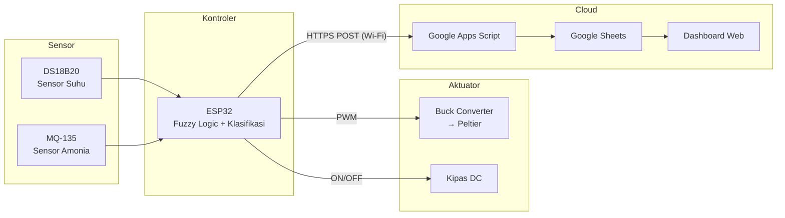
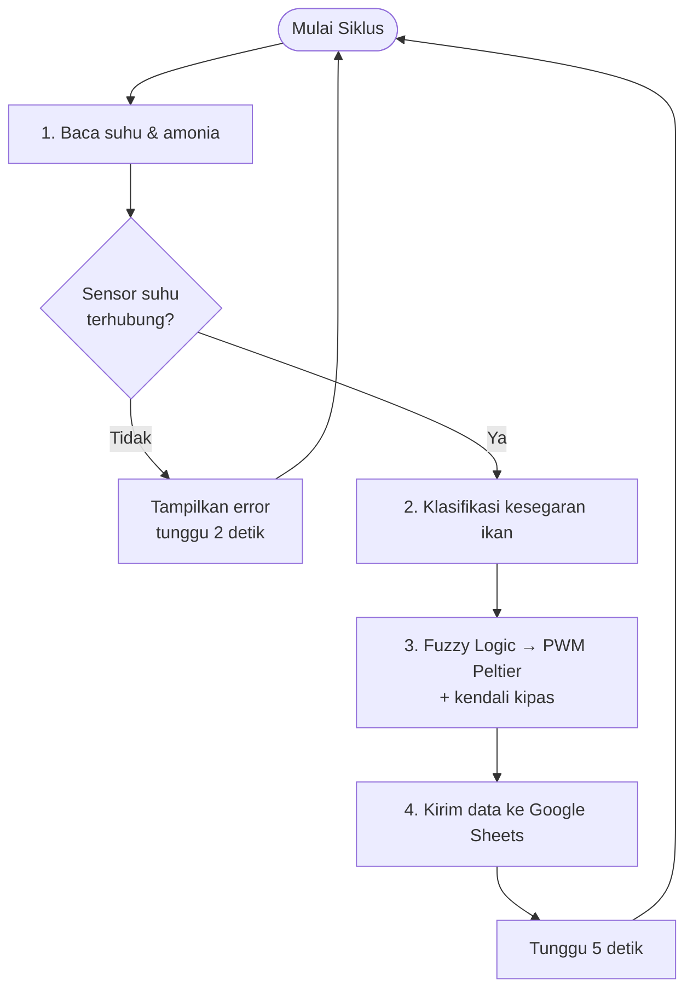

# 🐟 Smart Cold Storage — Sistem IoT Kendali Suhu & Monitoring Kesegaran Ikan


Prototipe **cold storage pintar** berbasis ESP32 untuk menjaga suhu penyimpanan ikan dan memantau kesegarannya secara *real-time*. Sistem membaca **suhu** (DS18B20) dan **kadar amonia** (MQ-135), mengatur daya **pendingin Peltier** menggunakan **Fuzzy Logic**, lalu mengirim data ke **Google Sheets** melalui Google Apps Script untuk ditampilkan di dashboard web.

<p align="center">
  
  &nbsp;
  
</p>

---

## 📑 Daftar Isi

- [Fitur Utama](#-fitur-utama)
- [Arsitektur Sistem](#-arsitektur-sistem)
- [Perangkat Keras](#-perangkat-keras)
- [Skema Rangkaian](#-skema-rangkaian)
- [Cara Kerja](#-cara-kerja)
- [Instalasi & Penggunaan](#-instalasi--penggunaan)
- [Format Data](#-format-data)
- [Hasil Pengujian](#-hasil-pengujian)
- [Dokumentasi Alat](#-dokumentasi-alat)
- [Struktur Repositori](#-struktur-repositori)
- [Catatan & Pengembangan Lanjutan](#-catatan--pengembangan-lanjutan)

---

## ✨ Fitur Utama

- **Monitoring suhu** ruang penyimpanan dengan sensor digital DS18B20.
- **Deteksi amonia** (indikator pembusukan ikan) dengan sensor gas MQ-135.
- **Klasifikasi kesegaran ikan** otomatis: `segar`, `waspada`, atau `busuk`.
- **Kendali Peltier berbasis Fuzzy Logic** (metode Sugeno, rata-rata berbobot) melalui sinyal PWM ke buck converter.
- **Kendali kipas otomatis** untuk pembuangan panas dan sirkulasi udara.
- **Pencatatan data ke cloud** (Google Sheets via Google Apps Script) setiap ±5 detik.
- **Dashboard web** untuk memantau suhu, amonia, status kesegaran, dan kinerja Peltier.

---

## 🏗 Arsitektur Sistem



---

## 🔧 Perangkat Keras

### Daftar Komponen

| No | Komponen | Fungsi |
|----|----------|--------|
| 1 | ESP32 DevKit (ESP-WROOM-32) | Mikrokontroler utama + koneksi Wi-Fi |
| 2 | DS18B20 | Sensor suhu ruang penyimpanan |
| 3 | MQ-135 | Sensor gas amonia (indikator kesegaran ikan) |
| 4 | Modul Peltier (TEC) + heatsink | Elemen pendingin |
| 5 | Buck converter (LM2596) | Pengatur daya Peltier |
| 6 | Kipas DC | Pembuang panas heatsink / sirkulasi udara |
| 7 | Adaptor DC + DC jack | Catu daya sistem |
| 8 | Modem MiFi | Sumber koneksi internet |
| 9 | Kotak styrofoam | Ruang penyimpanan berinsulasi |

### Konfigurasi Pin

| Komponen | Pin ESP32 | Mode | Keterangan |
|----------|-----------|------|------------|
| DS18B20 (data) | GPIO 5 | Input (pull-up) | Protokol OneWire |
| MQ-135 (analog out) | GPIO 25 | Input analog | ADC 12-bit (0–4095) |
| Buck converter / Peltier | GPIO 32 | Output PWM | Duty cycle 0–255 |
| Kipas | GPIO 34 | Output digital | ⚠️ Lihat [Catatan](#-catatan--pengembangan-lanjutan) |

---

## 🔌 Skema Rangkaian

<p align="center">
  
</p>

> Skema dibuat menggunakan Fritzing. Konfigurasi pin di firmware tetap menjadi acuan utama, jadi pastikan pengkabelan sesuai dengan tabel [Konfigurasi Pin](#konfigurasi-pin).

---

## ⚙️ Cara Kerja

Setiap siklus (±5 detik), firmware menjalankan empat tahap:



### 1. Pembacaan Sensor

- **Suhu** dibaca dari DS18B20 dalam °C.
- **Amonia** dibaca dari nilai ADC MQ-135 (0–4095), lalu dipetakan secara linier ke rentang **0–120 ppm**.

### 2. Klasifikasi Kesegaran Ikan

| Status | Kondisi |
|--------|---------|
| 🟢 **Segar** | Amonia ≤ 20 ppm **dan** suhu ≤ 25 °C |
| 🟡 **Waspada** | Amonia > 20 ppm **atau** suhu > 25 °C |
| 🔴 **Busuk** | Amonia ≥ 65 ppm (berapa pun suhunya) |

### 3. Kendali Fuzzy Logic (Sugeno)

**Fuzzifikasi.** Suhu dipetakan ke tiga himpunan fuzzy:

| Himpunan | Fungsi Keanggotaan | Output (PWM) |
|----------|--------------------|--------------|
| **Dingin** | 1 jika T ≤ 15 °C, turun linier di 15–17,5 °C | 0 (Peltier mati) |
| **Normal** | Segitiga 15 – 17,5 – 20 °C | 127 (±50%) |
| **Panas** | Naik linier di 17,5–20 °C, 1 jika T ≥ 20 °C | 255 (100%) |

**Defuzzifikasi** dilakukan dengan rata-rata berbobot (*weighted average*):

$$
PWM = \frac{\mu_{dingin} \cdot 0 + \mu_{normal} \cdot 127 + \mu_{panas} \cdot 255}{\mu_{dingin} + \mu_{normal} + \mu_{panas}}
$$

Hasilnya, daya Peltier berubah secara **halus dan proporsional** terhadap suhu, tidak sekadar ON/OFF. Target suhu penyimpanan ada di sekitar **15–20 °C**.

**Kendali kipas.** Kipas menyala jika Peltier sedang aktif (PWM > 0) **atau** amonia ≥ 65 ppm.

### 4. Pengiriman Data

Data dikirim melalui **HTTPS POST** (`application/x-www-form-urlencoded`) ke endpoint Google Apps Script. Script tersebut menyimpan data ke Google Sheets, lalu dashboard web membaca data dari sana.

---

## 🚀 Instalasi & Penggunaan

### Prasyarat

- [Arduino IDE](https://www.arduino.cc/en/software) 2.x
- **Board package ESP32** (Espressif Systems), dipasang lewat *Boards Manager*
- Library (dipasang lewat *Library Manager*):
  - `OneWire`
  - `DallasTemperature`
- Akun Google untuk Google Sheets & Apps Script

### Langkah-langkah

1. **Clone repositori**
   ```bash
   git clone https://github.com/aryajisantosa/iot-fish-temp-control.git
   cd iot-fish-temp-control
   ```

2. **Siapkan Google Sheets & Apps Script**
   - Buat Google Sheets baru, lalu buka **Extensions → Apps Script**.
   - Buat fungsi `doPost(e)` yang membaca parameter `suhu`, `amonia`, dan `status`, lalu menambahkannya sebagai baris baru di sheet.
   - **Deploy → New deployment → Web app**, dengan akses *Anyone*.
   - Salin URL deployment (`https://script.google.com/macros/s/.../exec`).

3. **Konfigurasi firmware**

   Buka [`firmware/fish_cold_storage/fish_cold_storage.ino`](firmware/fish_cold_storage/fish_cold_storage.ino), lalu sesuaikan:

   | Variabel | Isi dengan |
   |----------|------------|
   | `ssid` | Nama jaringan Wi-Fi |
   | `password` | Password Wi-Fi |
   | `url_google_script` | URL deployment Google Apps Script |

4. **Upload ke ESP32**
   - Pilih board **ESP32 Dev Module** dan port yang sesuai.
   - Klik **Upload**.

5. **Pantau hasil**
   - Buka **Serial Monitor** dengan baud rate **115200**.
   - Pastikan muncul pesan `Wi-Fi Terhubung!` dan setiap data berstatus `[SUKSES TERKIRIM]`.

---

## 📦 Format Data

Contoh *payload* yang dikirim ke Google Apps Script:

```
suhu=18.75&amonia=4.00&status=segar
```

| Parameter | Tipe | Keterangan |
|-----------|------|------------|
| `suhu` | float (2 desimal) | Suhu dalam °C |
| `amonia` | float (2 desimal) | Kadar amonia dalam ppm |
| `status` | string | `segar` / `waspada` / `busuk` |

Contoh output Serial Monitor:

```
Suhu: 18.75C | Amonia: 4.00ppm | Status: segar => [SUKSES TERKIRIM]
```

---

## 📊 Hasil Pengujian

Pengujian membandingkan kestabilan suhu dan pembacaan amonia **dengan** dan **tanpa** kendali Fuzzy Logic.

### Suhu

| Dengan Fuzzy Logic | Tanpa Fuzzy Logic |
|:------------------:|:-----------------:|
|  |  |
| Suhu berfluktuasi dalam rentang sempit (**±18,3–19,8 °C**) | Rentang suhu lebih lebar (**±16,6–21,7 °C**) |

### Amonia

| Dengan Fuzzy Logic | Tanpa Fuzzy Logic |
|:------------------:|:-----------------:|
|  |  |

### Dashboard & Log

| Dashboard Web | Log Serial |
|:-------------:|:----------:|
|  |  |

---

## 📸 Dokumentasi Alat

| Tampak Atas (Ruang Penyimpanan) | Tampak Samping (Panel Kontroler) |
|:-------------------------------:|:--------------------------------:|
|  |  |

🎥 **Video demo:** [docs/videos/device-demo.mp4](docs/videos/device-demo.mp4)

---

## 📁 Struktur Repositori

```
iot-fish-temp-control/
├── firmware/
│   └── fish_cold_storage/
│       └── fish_cold_storage.ino      # Firmware utama ESP32
├── docs/
│   ├── images/
│   │   ├── hardware/                  # Foto prototipe alat
│   │   ├── schematic/                 # Skema rangkaian (Fritzing)
│   │   ├── testing/                   # Grafik hasil pengujian
│   │   ├── dashboard/                 # Tampilan dashboard web
│   │   └── firmware/                  # Screenshot kode & serial monitor
│   └── videos/
│       └── device-demo.mp4            # Video demo alat
├── .gitignore
└── README.md
```

---

## 📝 Catatan & Pengembangan Lanjutan

> [!WARNING]
> **GPIO 34 pada ESP32 hanya bisa dipakai sebagai input** (*input-only*), jadi kipas tidak akan menyala jika dihubungkan ke pin tersebut. Hal ini terlihat dari pesan `gpio: GPIO can only be used as input mode` di Serial Monitor. Pindahkan kabel kipas ke pin output, misalnya **GPIO 27**, lalu sesuaikan nilai `pinKipas` di firmware.

> [!CAUTION]
> Kredensial Wi-Fi dan URL Google Apps Script masih ditulis langsung di dalam kode. Untuk penggunaan publik, sebaiknya pindahkan ke file terpisah (misalnya `secrets.h`, sudah terdaftar di `.gitignore`) dan *redeploy* URL Apps Script yang lama.

**Rencana pengembangan:**

- [ ] Kalibrasi sensor MQ-135 (nilai R₀ dan kurva ppm) agar pembacaan amonia lebih akurat dibanding pemetaan linier.
- [ ] Menambahkan kode sumber dashboard web dan Google Apps Script ke repositori.
- [ ] Mengganti `delay()` dengan *non-blocking timer* (`millis()`).
- [ ] Menambahkan notifikasi (Telegram / email) saat status berubah menjadi `busuk`.
- [ ] Menggunakan `WiFiClientSecure` dengan sertifikat root CA, bukan `setInsecure()`.
